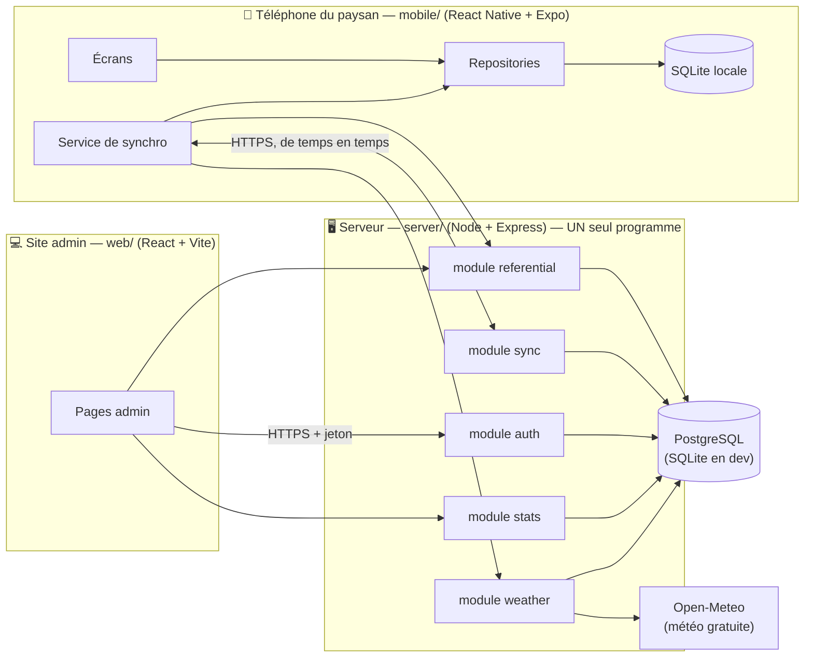
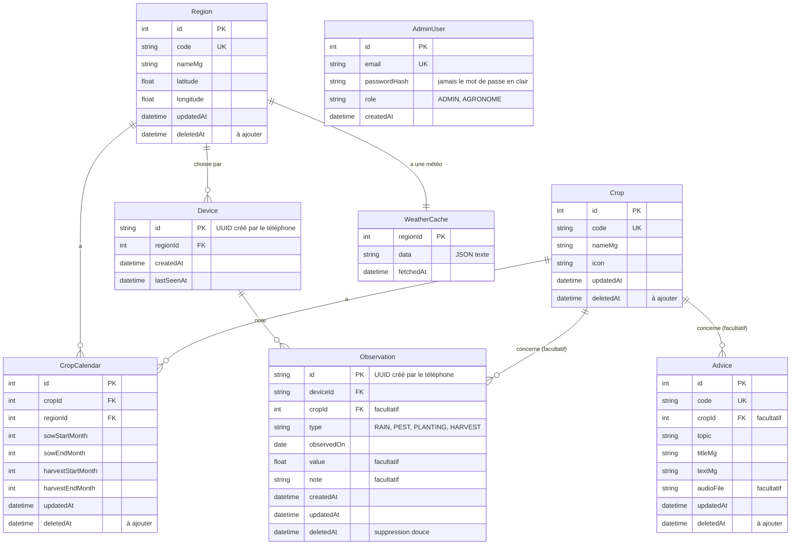

# Architecture de Tantsaha Connect

Ce document explique **comment le projet est organisé** et **pourquoi**. Il est écrit pour un débutant.
Les décisions sont justifiées en détail dans les [ADR](adr/README.md). L'API est décrite dans [API.md](API.md).

> Les schémas ci-dessous sont en **Mermaid** : GitHub les dessine automatiquement dans l'aperçu du fichier.

---

## 1. Monolithe, monolithe modulaire ou microservices ?

| | Monolithe classique | **Monolithe modulaire** | Microservices |
|---|---|---|---|
| **Définition** | Un seul programme, code rangé *par type* (`routes/`, `controllers/`, `services/`) | Un seul programme, code rangé *par sujet* (`weather/`, `sync/`…), chaque sujet bien isolé | Plusieurs petits programmes qui se parlent par le réseau |
| **Déploiement** | 1 serveur | 1 serveur | N serveurs à surveiller |
| **Complexité** | Faible | Faible à moyenne | Très élevée |
| **Coût d'hébergement** | Minimal | Minimal | Élevé |
| **Pour un développeur seul** | Bien au début, se brouille en grossissant | **Idéal** | Inadapté |

### Mon avis : **monolithe modulaire** ✅

1. **Un seul serveur à héberger et à surveiller** : indispensable en solo, avec un hébergement gratuit.
2. Le projet a des **sujets clairs et séparés** : *référentiel* (cultures, calendriers, conseils), *météo*, *synchronisation*, *authentification admin*, *statistiques*. On les range chacun dans son dossier.
3. Si un jour l'un d'eux doit devenir un service à part (la météo, par exemple), il suffit de le **sortir de son dossier** : les frontières existent déjà. On ne paie pas la complexité des microservices *avant* d'en avoir besoin.
4. Les microservices répondent à des problèmes d'**équipes nombreuses** et de **très forte charge**. Nous n'avons ni l'un ni l'autre.

> Exemple concret : aujourd'hui, pour modifier la météo, il faut ouvrir `routes/`, `controllers/` **et** `services/`. Demain, tout est dans `modules/weather/`.

---

## 2. Vue d'ensemble



**Idée centrale : « d'abord le téléphone » (*offline-first*).** L'application lit et écrit **toujours dans la base du téléphone**. Elle ne dépend jamais d'internet pour fonctionner. Quand le réseau est là, elle se synchronise en arrière-plan. Conséquence très utile : **si le serveur gratuit est endormi ou en panne, le paysan ne s'en aperçoit pas.**

---

## 3. Le serveur : organisé par modules

### Structure cible

```
server/src/
├── modules/
│   ├── referential/     Régions, cultures, calendriers, conseils (lecture publique + gestion admin)
│   │   ├── referential.routes.js
│   │   ├── referential.controller.js
│   │   ├── referential.service.js
│   │   └── index.js          ← la « vitrine » : ce que les autres modules ont le droit d'utiliser
│   ├── weather/         Prévisions Open-Meteo + cache
│   ├── sync/            Appareils, observations, push / pull
│   ├── auth/            Connexion de l'administrateur (e-mail + mot de passe → jeton)
│   └── stats/           Chiffres anonymes pour le tableau de bord
├── shared/
│   ├── db/prisma.js     Connexion unique à la base
│   ├── config/env.js    Lecture du .env
│   ├── middlewares/     errorHandler, requireAdmin, rateLimit, validation
│   └── errors/AppError.js
├── app.js               Assemble Express
└── server.js            Démarre le serveur
```

### Les règles (à ne pas casser)

1. **Dans un module** : `route → controller → service → Prisma`. Le controller tient en une ligne, sans logique. **Prisma n'est importé que dans les services.**
2. **Entre modules** : un module n'utilise **que** ce que l'autre expose dans son `index.js`. Interdit : `require('../weather/weather.service')` depuis `sync`. Autorisé : `require('../weather')`.
3. **`shared/` ne dépend d'aucun module.** Les modules dépendent de `shared/`, jamais l'inverse.
4. **Format d'erreur unique** pour toute l'API (voir API.md).

*Analogie* : un immeuble de bureaux. Chaque module est un bureau avec sa porte. On passe par l'accueil (`index.js`) pour demander quelque chose, on ne fouille pas dans les tiroirs du voisin.

---

## 4. L'application mobile

```
mobile/src/
├── screens/        Écrans (aucun SQL)
├── components/     Tuile, bouton « Henoy », bandeau hors ligne, sélecteur par image…
├── navigation/     Passage d'un écran à l'autre
├── db/             database.js (+ migrations) et *Repository.js : SEUL endroit avec du SQL
├── services/       api.js (SEUL endroit avec fetch), syncService, notifications, audio
├── domain/         Logique pure testable : moteur d'alertes, pictogrammes météo
├── data/           seed.json embarqué (régions, cultures, calendriers, conseils)
├── theme/          Couleurs (palette), tailles
└── i18n/           Tous les textes malagasy (mg.js)
```

`domain/` est nouveau : le **moteur d'alertes** (calendrier + date → « il faut semer ») est la logique la plus délicate du projet ; on la met dans une fonction pure, séparée de l'écran, pour pouvoir la tester.

Le **site web** (`web/`) est une application React séparée (Vite). Elle ne parle qu'à l'API `/api/v1/admin/*` et suit la même charte graphique.

---

## 5. Base de données

### 5.1 Pourquoi deux bases ?

| | Téléphone | Serveur |
|---|---|---|
| Technologie | SQLite (`expo-sqlite`) | SQLite en développement, **PostgreSQL** en production (via Prisma) |
| Rôle | Fonctionner sans internet | Centraliser, sauvegarder, servir le site admin |
| Contient | Notes du paysan, copie des références, dernière météo | Toutes les notes (anonymes), références officielles, cache météo, comptes admin |

**Pourquoi PostgreSQL en production et pas MySQL ou MongoDB ?** Les données sont **liées entre elles** (une note → une culture → une région) : une base *relationnelle* convient. PostgreSQL est gratuit, très répandu, bien supporté par Prisma, et proposé gratuitement par plusieurs hébergeurs. Voir [ADR 0004](adr/0004-express-prisma-postgresql.md).

### 5.2 Schéma du serveur



- `AdminUser` est **nouveau** (module `auth`). Le mot de passe est transformé par `bcrypt` : même la personne qui lit la base ne peut pas le retrouver.
- `deletedAt` est à **ajouter** aux 4 tables de référence : sinon, quand un admin supprime un conseil, les téléphones qui l'ont déjà ne le sauront jamais.
- Pas de `enum` ni de type `Json` Prisma : incompatibles avec SQLite. `type` et `data` sont des textes ; on passera à de vrais types PostgreSQL plus tard si utile.
- **Aucune donnée personnelle** (nom, numéro) n'est collectée : un `Device` n'est qu'un identifiant aléatoire.

### 5.3 Schéma du téléphone (SQLite)

Mêmes tables de référence (`regions`, `crops`, `calendars`, `advices`) en `snake_case`, plus :

| Table | Rôle |
|---|---|
| `meta` | Petits réglages : `device_id`, `region_id`, `last_pull` |
| `observations` | Comme le serveur + colonne **`synced`** (0 = pas encore envoyée) |
| `weather_cache` | Dernière météo reçue, par région |

Versionnée avec `PRAGMA user_version` (voir §7).

---

## 6. Synchronisation

| Étape | Ce qui se passe |
|---|---|
| **Push** | Le téléphone envoie ses observations `synced = 0`. Le serveur répond avec la liste des `id` acceptés ; le téléphone les marque `synced = 1`. |
| **Pull** | Le téléphone demande « donne-moi ce qui a changé depuis `last_pull` » et enregistre la réponse, y compris les éléments `deletedAt`. |
| **Quand** | Au démarrage **et** au retour du réseau (Sprint 3). Toujours en silence, jamais bloquant. |

Quatre astuces :
1. **UUID créé par le téléphone** → on peut noter sans internet, un renvoi ne crée pas de doublon.
2. **Suppression douce** (`deletedAt`) → le serveur et les autres téléphones apprennent les suppressions.
3. **Conflit** → la version la plus récente (`updatedAt`) gagne.
4. **Propriétaire** → le serveur refuse qu'un appareil modifie la note d'un autre (`deviceId` doit correspondre).

Limite connue : `pull` ne renvoie **pas** les notes → pas de restauration après réinstallation (priorité *Could*, M12).

---

## 7. Premier lancement hors ligne et évolution de la base

- **Données embarquées** : un fichier `mobile/src/data/seed.json`, généré depuis le serveur (`npm run export:seed`), est chargé dans SQLite au tout premier lancement. L'application est donc **utile avant la première synchro**.
- **Migrations SQLite** : `PRAGMA user_version` contient le numéro de version du schéma. Au démarrage, l'application exécute les migrations manquantes dans l'ordre. Ainsi, quand on ajoutera une colonne, les téléphones déjà installés seront mis à jour sans perdre les notes.

---

## 8. Sécurité (adaptée à ce projet)

| Sujet | Mesure |
|---|---|
| Paysans | Pas de compte, pas de donnée personnelle |
| Admin web | E-mail + mot de passe (bcrypt), jeton JWT à durée limitée, rôle `ADMIN` / `AGRONOME` |
| API publique | Limitation de débit (`express-rate-limit`), taille maximale des envois, validation des entrées |
| Secrets | Uniquement dans `.env` (jamais sur GitHub) |
| Transport | HTTPS en production (fourni par l'hébergeur) |
| CORS | En production, seul le domaine du site admin est autorisé |

---

## 9. Écart entre l'état actuel et la cible

| Aujourd'hui | Cible | Sprint |
|---|---|---|
| Serveur rangé par type (`routes/`, `controllers/`…) | Rangé par modules | 2 |
| URL `/api/...` | `/api/v1/...` | 2 |
| Pas de contrôle du propriétaire d'une note | `deviceId` vérifié | 2 |
| Pas de `deletedAt` sur les références | Ajouté | 2 |
| Pas d'`AdminUser`, ni de login | Module `auth` | 2 |
| SQLite mobile sans migrations | `PRAGMA user_version` | 3 |
| Application vide au 1ᵉʳ lancement hors ligne | `seed.json` embarqué | 3 |
| Synchro au démarrage seulement | + au retour du réseau | 3 |
| Pas de `web/` | Site admin React | 8 |
| Un dépôt Git imbriqué dans `mobile/` | Un seul dépôt à la racine | 0 |
